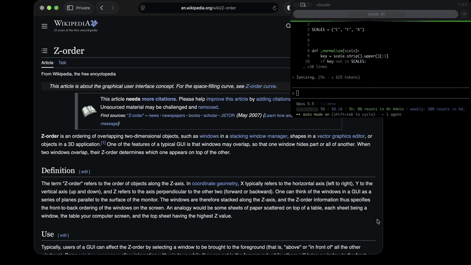
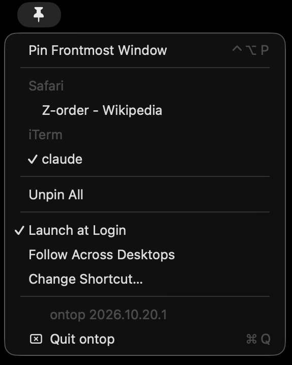

# ontop

A macOS menu bar utility that keeps any window visible above other apps' windows. Pick a
window from the menu, or press the shortcut while it is frontmost, and it stays on top until
you unpin it.

macOS gives no public way to raise another app's window level. So while another app is in
front, ontop shows a live mirror of the pinned window in a floating window of its own, and
hides the mirror when the pinned window comes to the front. The [proposal](docs/proposal.md)
is the original design, and the code has moved away from it in places. The
[ADRs](docs/adr/README.md) record the decisions in force.

ontop makes no network connections.

## Install

ontop needs macOS 26. Building it needs Xcode 26 or its Command Line Tools.

    git clone https://github.com/eladefrati/ontop.git
    cd ontop
    make install

`make install` builds the app and copies it to `/Applications`. If ontop is running,
`make install` quits it first and opens the new copy. Otherwise, open ontop from
Applications. It runs as a pin icon in the menu bar, with no Dock icon.

## Grant the two permissions

ontop needs Accessibility and Screen Recording. Its menu bar icon and **Quit ontop** are there
from launch, and the icon shows a slashed pin until both are granted. ontop shows no dialog
of its own. The only dialogs are macOS's prompts, one per permission, and the ontop menu
says what is missing and why.

1. macOS asks for Accessibility first. In System Settings > Privacy & Security >
   Accessibility, turn on ontop. The menu's **Open System Settings** opens that list.
   ontop sees the grant within a second.
2. macOS then asks for Screen Recording. On macOS 26 this request does not add ontop to the
   list in Privacy & Security > Screen & System Audio Recording. Click **+**, choose ontop in
   Applications, and turn it on.
3. Choose **Quit & Reopen** when macOS offers it. If you chose **Later**, choose **Relaunch
   ontop** in the ontop menu. A running ontop never sees a Screen Recording grant, so it has
   to start again.

If you rebuild with an ad-hoc signature (see [Build](#build)), macOS treats the new build as
a different app. The old ontop entries still look turned on but no longer apply. In both
lists, select each old ontop entry and click **-**, then add the app again with **+** and turn
it on.

macOS asks you to confirm Screen Recording access again about once a month.

## Use

- Click the pin in the menu bar and pick a window, or press Ctrl+Option+P while the window
  you want is in front. Pick it or press again to unpin. **Unpin All** clears every pin.
- The pinned window is the real window while you work in it. When another app comes to the
  front, a live mirror of the pinned window appears in its place. The mirror is at the
  floating window level, which is above ordinary windows, level with other apps' floating
  panels, and below the menu bar and the Dock.
- A click on the mirror goes to the real window. The first press brings the window to the
  front. ontop records the whole gesture, with its mouse button, modifier keys, click count,
  and drags, and replays it once the window is the top one at that point. A drag takes effect
  when you release the button. If the window doesn't come to the front within a second, ontop
  drops the gesture and beeps.
- With several windows pinned, the one you are working in is an ordinary window, so the
  other pins stay above it. Avoid overlapping two pins.
- A pinned window stays on the desktop it was pinned on. Turn on **Follow Across Desktops**
  to see pinned windows on every desktop and over full-screen apps. If you move a pinned
  window to another desktop in Mission Control, unpin it and pin it again there.
- **Change Shortcut** records a new key combination. ontop can't tell when another app uses
  the same combination, and then both apps respond to it.
- **Launch at Login** shows a dash while macOS waits for you to approve ontop as a login item.
  Choosing it then opens Login Items in System Settings.
- Pins are not remembered across launches.

A pin ends on its own when you minimize or close its window, when its app quits, or when
macOS fails to capture the window four times in a row. When a pin fails, ontop beeps and
shows the reason as the first line of its menu until your next pin or unpin. That covers a
pin that ends because capture failed, a window ontop can't pin, and a click on a mirror
whose window didn't come to the front in time.

Two limits follow from the design. The mirror takes no keyboard input or scrolling, and it
lags the real window by about a frame. An app can also mark a window as not capturable.
ontop leaves those windows out of its menu, and pressing the shortcut on one beeps and shows
the reason.

## Build

These are the main make targets:

    make            # build, bundle and sign build/ontop.app (same as make app)
    make run        # build, quit a running ontop, and launch build/ontop.app
    make install    # build, quit a running ontop, copy to /Applications, reopen it if it was running
    make uninstall  # quit ontop and delete /Applications/ontop.app; settings and grants stay
    make test       # run the unit tests
    make log        # stream the app's log
    make clean      # delete the build output

The Makefile signs with the first Apple Development certificate in your keychain, named by
its SHA-1 hash. To use another identity, pass `SIGN_IDENTITY=<hash or name>`. With no
certificate it signs ad hoc and prints a warning. Both run fine on the Mac that built them.
With an ad-hoc signature, macOS treats every rebuild as a new app, so you grant the two
permissions again after each build. A free Apple Development certificate avoids that.
Creating one needs full Xcode, not only the Command Line Tools. In Xcode, open Settings >
Accounts, add your Apple ID, select the Personal Team, click Manage Certificates, then
choose + > Apple Development. No paid developer program is needed.

Copies of the built app do not pass Gatekeeper on other Macs, since nothing here is
notarized. After the first blocked launch the recipient has to scroll to the Security
section of System Settings > Privacy & Security and click "Open Anyway", once.

## License

MIT, see [LICENSE](LICENSE).

Built with Claude Code.
